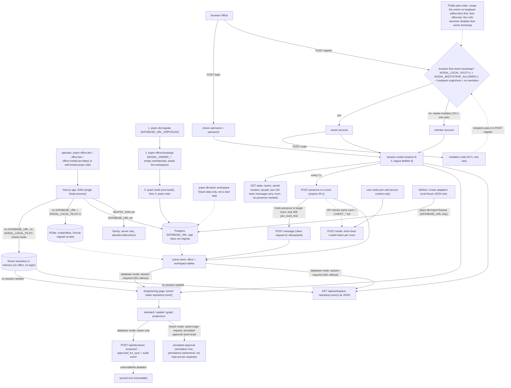
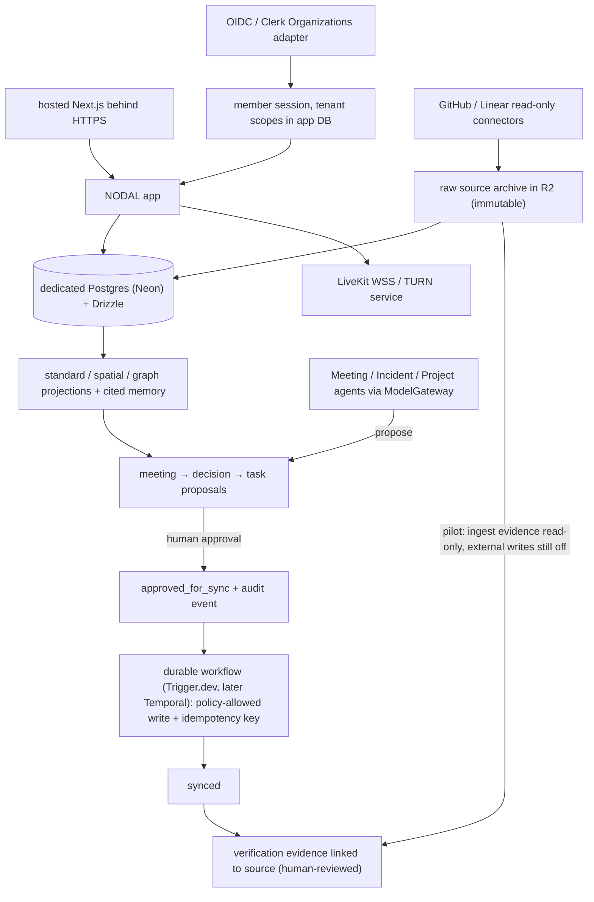

# 01 — Business process (As-Is / To-Be)

NODAL คือ shared office ของทีมแบบ local (บัญชีและคำเชิญ, ห้อง, presence, แชท, call ผ่าน LiveKit แบบเลือกได้) ร่วมกับ Engineering Room ที่แสดง signal งาน engineering แบบ standard / spatial / graph และให้ owner อนุมัติ decision ได้ วันนี้รันเฉพาะที่มีคนสั่งรัน (loopback, LAN หรือ self-hosted `pnpm start`) ยังไม่มี hosted deployment และ live URL สำหรับทีม

Last reviewed: 2026-11-28 · commit `48cf9a2`

## As-Is (จากโค้ดวันนี้)

Sources: `app/api/office/[action]/route.ts`, `app/api/workspace/route.ts`, `src/office/engineering.ts` (`engineeringContext`: fixture mode needs no session), `src/server/approval.ts` (fixture approval is a simulation), `src/components/office-shell.tsx` (join call), `app/api/decisions/route.ts`, `src/office/service.ts`, `src/office/http.ts`, `src/office/database.ts`, `app/engineering/page.tsx`, `scripts/database.ts`, `scripts/office-bootstrap.ts`, `src/adapters/sources.ts`, `src/domain/commands.ts`, `src/server/approval.ts`, `src/persistence/schema.ts`, `scripts/office-dev.ts`, `instrumentation.ts`, `README.md`, `PRODUCT.md` §Operations today

ข้อเท็จจริงจากโค้ดและ README:

- `canTransition` อนุญาตเฉพาะ `proposed → approved_for_sync` เมื่อมนุษย์อนุมัติ; ไม่มี executor สำหรับ `synced` และ API ตอบ `externalWrite: "disabled"`
- rate limit อยู่ใน process เดียว (`rateLimit` ใน `src/office/http.ts`); PGlite ห้ามรันสอง server บนข้อมูลชุดเดียว
- `login` ตรวจรหัสผ่านแล้วออก session โดยไม่ผ่านเงื่อนไขสมัคร; browser bootstrap ต้องมี `NODAL_BOOTSTRAP_ALLOWED=1` ซึ่ง `scripts/office-dev.ts` ตั้งให้เฉพาะ loopback ที่ไม่ใช่ `--lan` ส่วน Postgres ใช้ `pnpm office:bootstrap`
- `officeDatabase` migrate อัตโนมัติเฉพาะ PGlite; Postgres ต้อง `pnpm db:migrate` ก่อนเปิดแอป และ `pnpm db:import-fixtures` ใช้ได้กับ Postgres (`DATABASE_URL`) เท่านั้น
- แชตและ LiveKit token ตอบ `409 join_room_first` ถ้าไม่มี presence ที่ยังไม่หมดอายุในห้องนั้น
- session หมดอายุ 8 ชม. และถูกลบเมื่อ logout; คำเชิญหมดอายุ 24 ชม. และใช้ได้ครั้งเดียว (`src/office/service.ts`)
- `pnpm dev` ที่ไม่มี `DATABASE_URL` และไม่ opt-in office ยังเปิด V1 fixture แบบ ephemeral
- terrain, incidents, meeting extraction และพฤติกรรม agent ยังเป็น simulation (`PRODUCT-PLAN.md` §Pilot V1)

## To-Be (`PRODUCT-PLAN.md` §Roadmap V1–V4, §Production tech stack, §Safety / rollout; `PRODUCT.md` §Production promise; `README.md` §Internet/team deployment)

Sources: `PRODUCT-PLAN.md` (§Roadmap table V1–V4, §Production tech stack, §Canonical event model, §Safety / rollout), `PRODUCT.md` §Production promise, §V1 success metrics, `README.md` §Internet/team deployment, §Remaining gaps, `docs/AI-WORKFLOW.md` §Before a real team pilot

## Gap

| ID | As-Is → To-Be | Status | Owner | Evidence |
|---|---|---|---|---|
| G1 | มีขั้นตอน self-hosted / internet pilot แล้ว (`pnpm db:migrate`, `office:bootstrap`, `pnpm start`) แต่ยังไม่มี deployment จริงและ URL สำหรับทีม → hosted HTTPS + Postgres + LiveKit WSS/TURN ที่ทีมเข้าได้ | decide | owner | `PRODUCT.md` §Operations today; `README.md` §Internet/team deployment "not deployed by this change" |
| G2 | GitHub / Linear adapters รับ fixture JSON เท่านั้น → live read-only ingestion (V1 pilot); เปิดได้หลัง G3 (immutable archive) และ authentication/membership พร้อมเท่านั้น | todo | claude | `src/adapters/sources.ts`; `PRODUCT-PLAN.md` §Roadmap V1, บรรทัด 66–70 |
| G3 | ไม่มี raw source archive → archive ใน R2 แบบ immutable ก่อนเป็น projection | todo | claude | `README.md` §Remaining gaps; `PRODUCT-PLAN.md` §Safety / rollout |
| G4 | หยุดที่ `approved_for_sync`, `synced` ทำไม่ได้ → durable workflow ทำ write ที่ policy อนุญาตพร้อม idempotency key (V2) | todo | claude | `src/domain/commands.ts` `canTransition`; `PRODUCT-PLAN.md` §Roadmap V2 |
| G5 | verification ยัง pending → verification evidence จริงที่ link กลับ source (รับได้ตั้งแต่ pilot ที่ external writes ยังปิด) | todo | claude | `README.md` §Engineering persistence; `PRODUCT.md` §Job to be done; `docs/AI-WORKFLOW.md` §Before a real team pilot |
| G6 | meeting extraction และ agent เป็น simulation → Meeting / Incident / Project agents ผ่าน ModelGateway พร้อม evaluation (V3) | todo | claude | `PRODUCT-PLAN.md` §Pilot V1, §Roadmap V3; `evals/meeting-decision.v1.json` |
| G7 | auth แบบ password / session ในแอป → OIDC / Clerk Organizations adapter | todo | claude | `src/office/service.ts`; `PRODUCT-PLAN.md` §Production tech stack (Identity) |
| G8 | rate limit ใน process, PGlite process เดียว; session (8 ชม., ลบเมื่อ logout) และคำเชิญ (24 ชม., ใช้ครั้งเดียว) มีพื้นฐานแล้วแต่ไม่มีการจัดการระดับ production (ยกเลิกคำเชิญ, revoke session, ลบสมาชิก, password recovery), retention, backup/restore → shared abuse controls และ production controls | todo | claude | `README.md` §Remaining gaps "Production needs ..."; `src/office/service.ts` `session` / `invite` |
| G9 | ยังไม่ได้วัด V1 success metrics (8/10 decisions ใน 3 นาที ฯลฯ) → pilot กับ 1 ทีม | todo | owner | `PRODUCT.md` §V1 success metrics; `PRODUCT-PLAN.md` §Roadmap V1 |
| G10 | `PRODUCT.md` บอกว่า "general-purpose virtual office" อยู่นอก scope V1 แต่โค้ดสร้าง Shared Office แล้ว → owner ยืนยัน scope และแก้ `PRODUCT.md` | decide | owner | `PRODUCT.md` §Out of scope for V1; `PRODUCT-PLAN.md` §Shared Office |
| G11 | diagram รวมทางที่ไม่มี session เป็นเส้นเดียว ไม่แยกว่าหน้าเว็บพาไปหน้า login แต่ API ตอบ HTTP 401 (Codex review รอบ 3, P3, owner ให้จดไว้แทนการวาดใหม่ 2026-11-28) → แยกสองทางนี้เมื่อแก้ diagram ครั้งถัดไป | todo | claude | Codex Stop-hook review 2026-11-28; `src/office/service.ts` `session` |
| G12 | As-Is ไม่ได้บอกว่าโหมด Postgres (ไม่มี `NODAL_LOCAL_PILOT=1`) ตั้ง session cookie เป็น `Secure` ทีมที่เปิด `http://<LAN-IP>:3400` จึงล็อกอินไม่ติด (Codex review รอบ 4, P2, จดไว้แทนการวาดใหม่ 2026-11-28) → แสดง HTTPS เป็นเงื่อนไขของการเข้าจากเครื่องอื่นเมื่อแก้ diagram ครั้งถัดไป | todo | claude | `app/api/office/[action]/route.ts` cookie `secure`; `README.md` §Internet/team deployment |
| G13 | As-Is ไม่ได้บอกว่า `office:media:lan` ต้องตั้ง `NODAL_MEDIA_HOST` เป็น LAN IP ของเครื่อง host ไม่งั้น launcher หยุดก่อนเปิด Next.js (Codex review รอบ 4, P3, 2026-11-28) → ระบุตัวแปรนี้เมื่อแก้ diagram ครั้งถัดไป | todo | claude | `scripts/office-dev.ts` `NODAL_MEDIA_HOST`; `README.md` §LAN |

## Open questions

- hosted pilot จะใช้ Neon / Railway / Vercel ที่ไหน และ LiveKit แบบ self-host หรือ cloud ไม่มีเอกสารตัดสินไว้ [ต้องยืนยัน]
- Clerk Organizations เป็นทางเลือกที่ owner รับแล้ว หรือเป็นแค่ทิศทางใน plan
