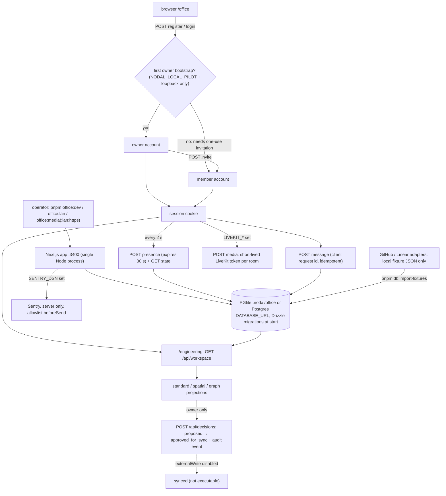
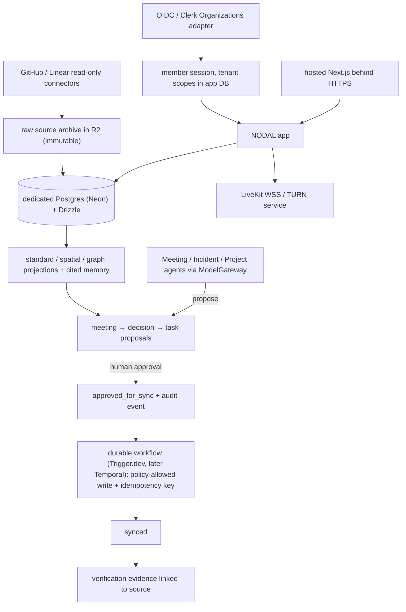

# 01 — Business process (As-Is / To-Be)

NODAL คือ shared office ของทีมแบบ local (บัญชีและคำเชิญ, ห้อง, presence, แชท, call ผ่าน LiveKit แบบเลือกได้) ร่วมกับ Engineering Room ที่แสดง signal งาน engineering แบบ standard / spatial / graph และให้ owner อนุมัติ decision ได้ วันนี้รันเฉพาะบนเครื่องหรือ LAN ที่มีคนสั่งรัน ยังไม่มี hosted deployment

Last reviewed: 2026-11-28 · commit `48cf9a2`

## As-Is (จากโค้ดวันนี้)

Sources: `app/api/office/[action]/route.ts`, `app/api/workspace/route.ts`, `app/api/decisions/route.ts`, `src/office/service.ts`, `src/office/http.ts`, `src/office/database.ts`, `src/adapters/sources.ts`, `src/domain/commands.ts`, `src/server/approval.ts`, `src/persistence/schema.ts`, `scripts/office-dev.ts`, `instrumentation.ts`, `README.md`, `PRODUCT.md` §Operations today

ข้อเท็จจริงจากโค้ดและ README:

- `canTransition` อนุญาตเฉพาะ `proposed → approved_for_sync` เมื่อมนุษย์อนุมัติ; ไม่มี executor สำหรับ `synced` และ API ตอบ `externalWrite: "disabled"`
- rate limit อยู่ใน process เดียว (`rateLimit` ใน `src/office/http.ts`); PGlite ห้ามรันสอง server บนข้อมูลชุดเดียว
- `pnpm dev` ที่ไม่มี `DATABASE_URL` และไม่ opt-in office ยังเปิด V1 fixture แบบ ephemeral
- terrain, incidents, meeting extraction และพฤติกรรม agent ยังเป็น simulation (`PRODUCT-PLAN.md` §Pilot V1)

## To-Be (`PRODUCT-PLAN.md` §Roadmap V1–V4, §Production tech stack, §Safety / rollout; `PRODUCT.md` §Production promise; `README.md` §Internet/team deployment)

Sources: `PRODUCT-PLAN.md` (§Roadmap table V1–V4, §Production tech stack, §Canonical event model, §Safety / rollout), `PRODUCT.md` §Production promise, §V1 success metrics, `README.md` §Internet/team deployment, §Remaining gaps

## Gap

| ID | As-Is → To-Be | Status | Owner | Evidence |
|---|---|---|---|---|
| G1 | รันได้แค่ loopback / LAN, ไม่มี live URL → hosted HTTPS + Postgres + LiveKit WSS/TURN | decide | owner | `PRODUCT.md` §Operations today; `README.md` §Internet/team deployment "not deployed by this change" |
| G2 | GitHub / Linear adapters รับ fixture JSON เท่านั้น → live read-only ingestion (V1 pilot) | todo | claude | `src/adapters/sources.ts`; `PRODUCT-PLAN.md` §Roadmap V1 |
| G3 | ไม่มี raw source archive → archive ใน R2 แบบ immutable ก่อนเป็น projection | todo | claude | `README.md` §Remaining gaps; `PRODUCT-PLAN.md` §Safety / rollout |
| G4 | หยุดที่ `approved_for_sync`, `synced` ทำไม่ได้ → durable workflow ทำ write ที่ policy อนุญาตพร้อม idempotency key (V2) | todo | claude | `src/domain/commands.ts` `canTransition`; `PRODUCT-PLAN.md` §Roadmap V2 |
| G5 | verification ยัง pending → verification evidence จริงที่ link กลับ source | todo | claude | `README.md` §Engineering persistence; `PRODUCT.md` §Job to be done |
| G6 | meeting extraction และ agent เป็น simulation → Meeting / Incident / Project agents ผ่าน ModelGateway พร้อม evaluation (V3) | todo | claude | `PRODUCT-PLAN.md` §Pilot V1, §Roadmap V3; `evals/meeting-decision.v1.json` |
| G7 | auth แบบ password / session ในแอป → OIDC / Clerk Organizations adapter | todo | claude | `src/office/service.ts`; `PRODUCT-PLAN.md` §Production tech stack (Identity) |
| G8 | rate limit ใน process, PGlite process เดียว, ไม่มี lifecycle ของ session / invitation, retention, backup/restore → shared abuse controls และ production controls | todo | claude | `README.md` §Remaining gaps "Production needs ..." |
| G9 | ยังไม่ได้วัด V1 success metrics (8/10 decisions ใน 3 นาที ฯลฯ) → pilot กับ 1 ทีม | todo | owner | `PRODUCT.md` §V1 success metrics; `PRODUCT-PLAN.md` §Roadmap V1 |
| G10 | `PRODUCT.md` บอกว่า "general-purpose virtual office" อยู่นอก scope V1 แต่โค้ดสร้าง Shared Office แล้ว → owner ยืนยัน scope และแก้ `PRODUCT.md` | decide | owner | `PRODUCT.md` §Out of scope for V1; `PRODUCT-PLAN.md` §Shared Office |

## Open questions

- hosted pilot จะใช้ Neon / Railway / Vercel ที่ไหน และ LiveKit แบบ self-host หรือ cloud ไม่มีเอกสารตัดสินไว้ [ต้องยืนยัน]
- Clerk Organizations เป็นทางเลือกที่ owner รับแล้ว หรือเป็นแค่ทิศทางใน plan
